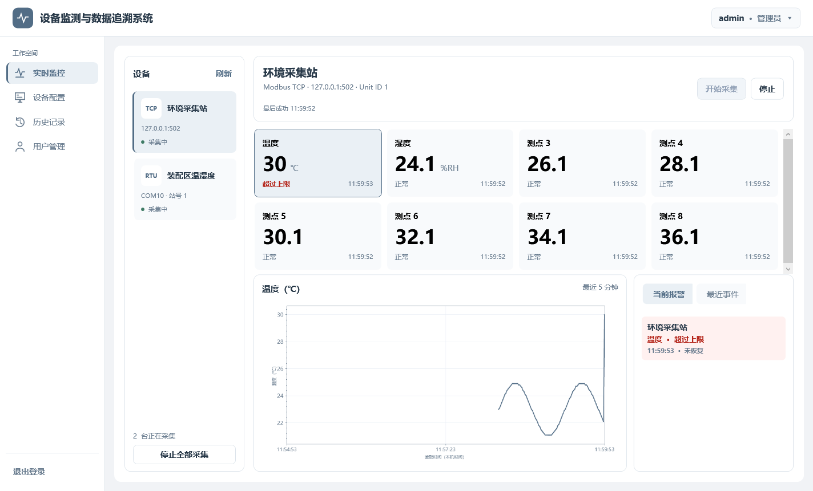
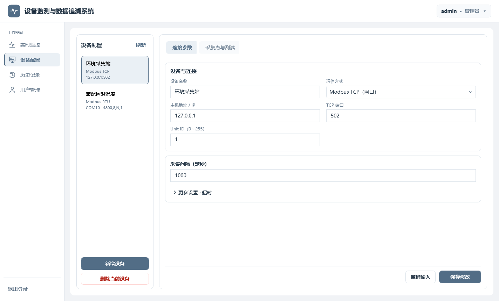
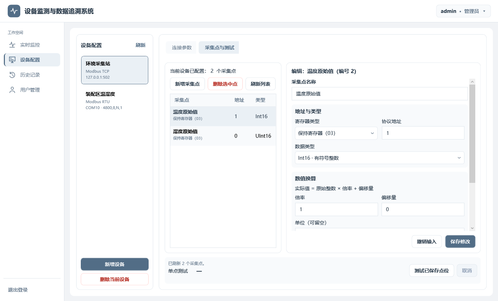
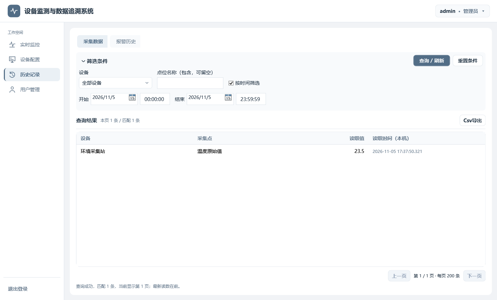
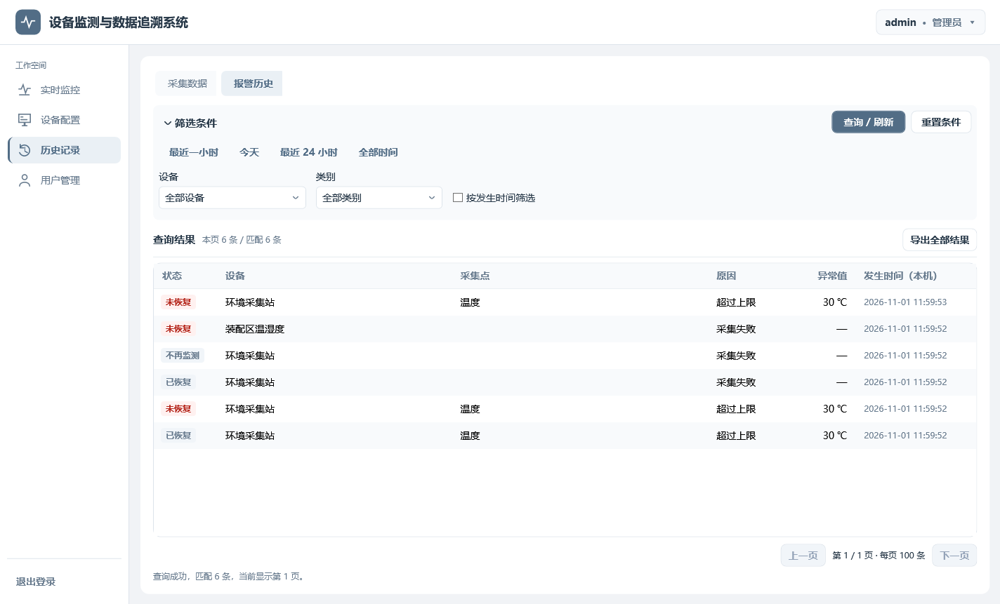
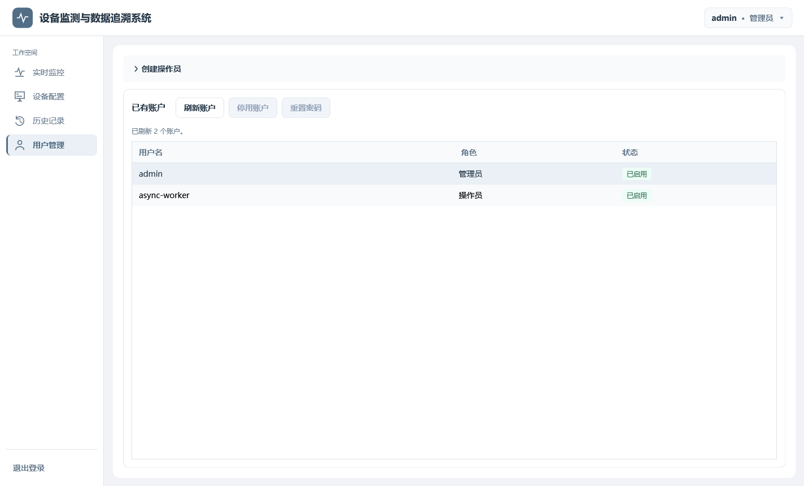

# DeviceMonitor · 设备监控与数据追溯系统

面向 Modbus TCP / RTU 设备的 Windows 桌面应用，提供设备与点位配置、多设备轮询采集、实时曲线、阈值报警、历史查询及 CSV 导出。

项目使用 C#、WPF / MVVM、NModbus 和 EF Core + SQLite，已完成真实温湿度传感器的 RTU 接入与读数验证。



界面截图使用模拟数据；实物验证为单台 RTU 温湿度传感器。

## 核心功能

| 模块 | 功能 |
| --- | --- |
| 设备接入 | 在同一页维护连接参数与采集点，支持单点测试，无需额外启用设备 |
| 数据采集 | 按点位配置自动合并连续地址、分批读取，支持多设备轮询和数值换算 |
| 任务管理 | 正常轮次复用连接，通信故障延迟重连，支持取消与停止收尾 |
| 实时监控 | 选择设备查看读数卡片，点卡片切换曲线；并列显示当前报警与最近事件 |
| 报警记录 | 上下限报警、采集异常、持续事件合并，以及恢复和停止监测状态 |
| 历史追溯 | 按设备、点位名称和时间筛选，支持分页与可取消的 CSV 全量结果导出 |
| 账户与日志 | 管理员 / 操作员权限、密码管理，以及本地操作与异常日志 |

## 更多界面

<details>
<summary>点位配置与单点测试</summary>

设备列表与连接参数放在同一工作区；切到“采集点与测试”即可编辑点位、换算和报警参数，不必连续打开多个弹窗。






</details>

<details>
<summary>历史查询与报警记录</summary>

采集历史集中提供条件查询、分页和 CSV 导出，导出范围是本次查询匹配的全部页；报警历史展示关键字段，选中行可查看详细说明、次数及恢复时间。




</details>

<details>
<summary>账户管理与角色权限</summary>

管理员负责设备配置和账户管理；操作员可以启停采集、查询历史与导出，不可修改设备或账户。




</details>

## 技术栈

| 部分 | 技术 |
| --- | --- |
| 桌面界面 | C#、.NET 10、WPF、XAML |
| 界面组织 | MVVM、CommunityToolkit.Mvvm |
| 设备通信 | NModbus、Modbus TCP / RTU、System.IO.Ports |
| 数据访问 | EF Core 10、LINQ、SQLite、EF Migrations |
| 任务协作 | Task、async/await、CancellationToken、SemaphoreSlim |
| 图表与日志 | ScottPlot.WPF、Serilog.Sinks.File |

## 快速开始

### 运行环境

- Windows 10（2004 / 19041 或更新版本）或 Windows 11，安装 .NET 10 SDK。
- 使用 Visual Studio 时，需支持 .NET 10 并安装“.NET 桌面开发”工作负载。
- 实物 RTU 通信需准备 USB 转 RS-485 适配器、驱动，以及符合设备要求的供电与接线。

在仓库根目录执行：

```powershell
dotnet restore DeviceMonitor.slnx
dotnet build DeviceMonitor.slnx -c Release
dotnet run --project DeviceMonitor/DeviceMonitor.csproj -c Release
```

也可以打开 `DeviceMonitor.slnx`，解决方案中只有一个 `DeviceMonitor` WPF 项目。

### 首次使用

1. 程序启动时自动应用已有数据库迁移；空库通过登录页创建首个管理员，没有预置密码。
2. 在“设备配置”中新增设备，填写 IP / 端口或 COM / 波特率 / 校验位 / 停止位及站号。保存后刷新列表并清空选择，再从列表点击要配置的设备。
3. 切到“采集点与测试”，按设备手册配置点位；保存后选中点位执行单点测试，核对地址、数据类型与倍率。测试不写历史。
4. 在实时监控中选择设备并开始采集，选择其他设备也可分别启动；点击点位卡片查看曲线。切换显示不会停止其他设备。
5. 在历史记录中按条件查询、翻页或导出全部匹配结果；需要看实时曲线时，在监控页选择点位卡片。修改正在使用的配置前，先停止对应设备。

配置页中选中设备或点位即可编辑；刷新设备列表后不自动选择设备，右侧显示“请选择设备”。保存设备后同样由用户重新选择，不自动切换标签。切换对象或手动刷新会放弃未保存的输入；“撤销输入”恢复已保存值。不再设置独立的设备启用状态。

连接前应核对设备供电、接线和通信参数；协议地址以设备手册为准，不能直接把 `40001` 一类显示地址当成报文地址。

### 数据位置

```text
%LOCALAPPDATA%/DeviceMonitor/device-monitor.db
%LOCALAPPDATA%/DeviceMonitor/Logs/
```

数据库、日志和导出文件不随源码分发。正常启动不清库；CSV 是历史数据导出，不是完整数据库备份。

## 实现要点

- **连接与调度分开**：各设备维护采集任务；健康连接跨轮次复用。共用 COM 口的 RTU 设备共享串口，并串行完成每次请求响应。
- **按错误类型恢复**：连接和收发故障清理失效连接后等待重试；设备忙保留连接；配置类异常结束任务并提示。
- **按配置读取**：同类连续地址自动合并，每组不超过 125 个寄存器；地址间隔或 03/04 不同自动分组。一轮全部成功才更新读数和保存，不补零冒充成功。
- **统一数值转换**：寄存器先按 UInt16 / Int16 解释，再应用倍率和偏移；显示、报警、历史与导出使用同一实际值。
- **异步界面与安全停止**：同步库调用放在线程池；各页面通过统一入口收尾，取消后等待已开始的读取和保存完成，再释放连接。
- **报警与日志**：持续越限合并为同一事件；通信故障按设备记录，成功响应后恢复。日志记录简短操作和原因，同错误限频，文件轮换交给 Serilog。
- **数据一致性**：每轮成功读数批量提交，报警按批查询和更新，每次数据库操作独立创建上下文；失败读数不以旧值或零值冒充成功。
- **历史查询与导出**：筛选和分页在数据库执行；翻页、导出沿用当前结果的查询条件及记录编号上限。CSV 分批写入临时文件，可取消，成功后替换目标文件。

核心实现：[采集任务](DeviceMonitor/ViewModel/DeviceSamplingViewModel.cs) · [通信读取](DeviceMonitor/Services/ModbusPointReader.cs) · [报警处理](DeviceMonitor/ViewModel/AlarmMonitor.cs) · [历史存取](DeviceMonitor/Services/HistoryStore.cs)

## 回归检查

检查程序使用模拟串口、本机 TCP 回环和临时数据库，不连接真实设备，也不访问应用的实际数据库。

```powershell
# RTU：批量读取、同口多站、取消及资源释放
dotnet run --project tests/DeviceMonitor.RtuChecks/DeviceMonitor.RtuChecks.csproj -c Release

# TCP：分段响应、连接复用与故障恢复
dotnet run --project tests/DeviceMonitor.RtuChecks/DeviceMonitor.RtuChecks.csproj -c Release -- --tcp

# 数据库：迁移、账户、配置、历史查询与批量事务
dotnet run --project tests/DeviceMonitor.PersistenceChecks/DeviceMonitor.PersistenceChecks.csproj -c Release

# WPF：绑定、命令、选择、布局与退出收尾
dotnet run --project tests/DeviceMonitor.UiChecks/DeviceMonitor.UiChecks.csproj -c Release
```

## 项目结构

```text
DeviceMonitor.slnx
DeviceMonitor/
  DeviceMonitor.csproj      # 单个 WPF 项目
  View/                    # WPF 页面、弹窗与曲线绘制
  ViewModel/               # 界面数据、命令、采集与报警协调
  Model/                   # 设备、点位、读数、账户与数据库实体
  Services/                # 通信、数据库操作、CSV 和日志
  Migrations/              # EF 迁移与模型快照
tests/                     # 通信、数据库和界面回归检查
docs/images/               # 界面截图
```

## 支持范围

- 读取保持寄存器 `03` / 输入寄存器 `04`；每个点占一个寄存器，支持 `UInt16` / `Int16`。
- 支持同设备的不连续地址和 03/04 混合配置，自动分组读取；同类重复地址拒绝。每个点仍是一个 16 位寄存器，暂不含浮点多寄存器解析或控制写入。
- 当前报警状态在本次采集中维护；重启保留历史，不自动把旧报警当作当前报警。
- 当前为交互式桌面程序，不是 Windows 后台服务，也不承担 PLC 安全联锁职责。
- 取消会等待已开始的同步库调用完成或超时，不保证立即中断底层驱动。
- 实物验证为单台 RTU 温湿度传感器；模拟回归不等同于工业现场长期稳定性验证。

第三方组件许可与来源见 [THIRD-PARTY-NOTICES.md](THIRD-PARTY-NOTICES.md)。
